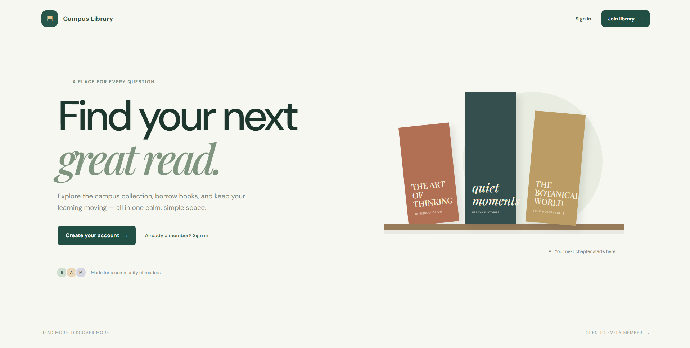
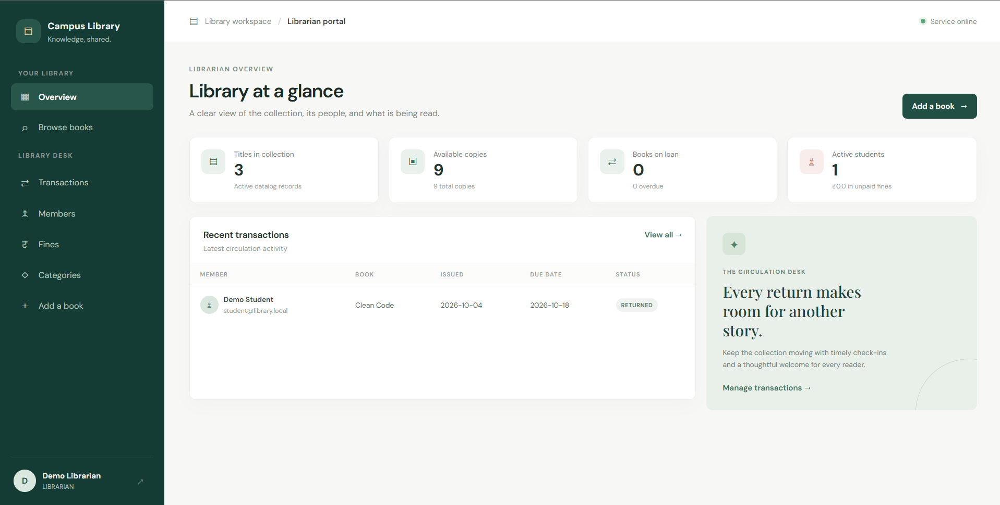
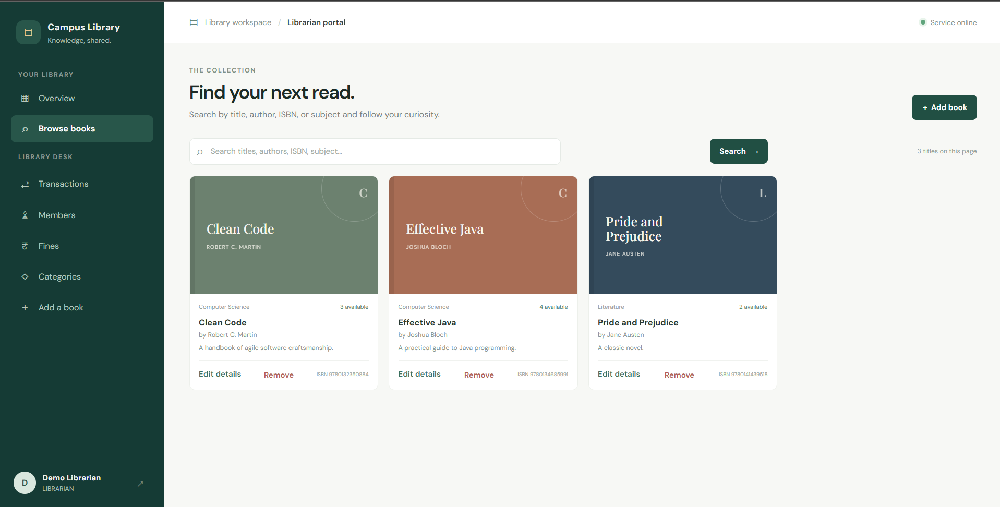

# Campus Library Management System

## Project Overview

Campus Library is a Java 17 web application for managing a college library catalog, member accounts, book circulation, and overdue fines. It is built as a traditional Java Web application for evaluation of Java, JDBC, Servlet, and JSP concepts.

## Problem Statement

Manual library records make it difficult to find books, track copies and due dates, manage member access, and calculate overdue charges consistently. The system centralizes these workflows and records them in a relational database.

## Proposed Solution

The application uses MVC with JSP views, Jakarta Servlet controllers, service interfaces for business rules, DAO interfaces with direct JDBC implementations, and MySQL persistence. It packages as a WAR for Apache Tomcat; it is not a standalone executable.

```text
Browser → JSP / HTML / CSS / JavaScript → Jakarta Servlets → Service layer → DAO layer → JDBC → MySQL
```

## Features

- Student registration, login, profile updates, password changes, borrowing history, and fine viewing.
- Optional librarian applications with administrator approval.
- Search the catalog by title, author, ISBN, or category.
- Librarian book and category management, member account management, returns, and fine payment recording.
- Five-book borrowing limit, duplicate-loan prevention, 14-day due dates, and configurable late fines (default ₹5/day).
- Dashboard totals for catalog, available copies, active loans, overdue books, students, pending librarian applications, and unpaid fines.
- BCrypt password hashes, role-based access, session rotation, CSRF protection on authenticated POST forms, and responsive pages.

## User Roles

| Role | Main capabilities |
|---|---|
| Student | Browse/search, borrow eligible books, view active loans/history/fines, manage profile and password. |
| Librarian | Manage books/categories/members, record returns, review circulation and fines. |
| Administrator | Access librarian workflows and approve or reject librarian applications. |

## Technology Stack

- Java 17; Jakarta Servlet 6; JSP 3.1; JSTL 3 and Expression Language.
- JDBC with MySQL Connector/J and a process-wide HikariCP connection pool; Flyway-managed MySQL 8 schema.
- SLF4J/Logback operational logging, audit records, and Testcontainers-backed MySQL integration tests.
- Maven WAR packaging; Apache Tomcat 10.1+.
- HTML, CSS, and JavaScript for presentation and browser interactions.
- BCrypt for password hashing.

## System Architecture

- **Model:** Encapsulated domain types for users, books, categories, issues, and fines.
- **Servlet/controller:** Handles HTTP requests, calls services, and forwards request data to JSP views.
- **Service:** Validates input and applies account, catalog, circulation, and fine rules.
- **DAO:** Defines persistence contracts; implementations use SQL and JDBC directly.
- **Database:** Stores related records with primary keys, foreign keys, unique constraints, checks, and indexes.

## Project Structure

```text
database/                         schema, sample data, reset script
src/main/java/com/library/model   domain models
src/main/java/com/library/dao     DAO interfaces and JDBC implementations
src/main/java/com/library/service service interfaces and implementations
src/main/java/com/library/servlet HttpServlet controllers
src/main/java/com/library/filter  authentication, authorization, CSRF filters
src/main/java/com/library/exception custom application exceptions
src/main/java/com/library/util    JDBC connection, password, validation utilities
src/main/webapp                   public JSPs, protected views, CSS, JavaScript, web.xml
src/test/java                     Java behavior and JSP compilation checks
pom.xml                            Maven WAR build
RUBRIC_MAPPING.md                  source-file mapping to the college rubric
TESTING.md                         automated and manual verification checklist
```

## Database Design

`database/schema.sql` creates five related tables:

| Table | Purpose |
|---|---|
| `users` | Student, librarian, and administrator accounts and status. |
| `categories` | Book categories. |
| `books` | Catalog details, category relationship, copy counts, and archive state. |
| `book_issues` | Borrower, book, issue/due/return dates, and circulation status. |
| `fines` | Fine amount and payment state for a returned issue. |

The schema declares primary and foreign keys, unique email/membership/ISBN/category values, copy-count validation, and indexes for catalog and loan lookups. Review the SQL before applying it to an existing database. `database/reset_database.sql` is destructive: it drops and recreates `library_management`.

## JDBC Implementation

`src/main/java/com/library/util/DBConnection.java` owns one lazily initialized HikariCP pool. Every DAO obtains a pooled connection through `DBConnection.getConnection()` and closes it with try-with-resources. Pool size and timeouts are configurable with `DB_POOL_*` variables. `IssueDAOImpl` uses transactions and row locks for checkout and return; database locks protect concurrency across application instances.

## Multithreading & Synchronization

`LibraryContextListener` starts a bounded `LibraryTaskExecutor` when the web application starts and shuts it down when the application stops. Its scheduled `FineCalculationTask` runs daily in the background, recalculates fines for overdue loans through `IssueService`, and persists them through `FineService`/`FineDAO`. Task failures are logged per loan so one bad record does not stop the remaining calculations. The overdue-fine upsert only applies while the loan remains overdue and active; already-paid fines retain their paid state.

`IssueServiceImpl` uses a fixed set of Java monitor locks, selected by book ID, around issue and return operations. This coordinates competing requests within one application instance without creating an unbounded lock per book. `IssueDAOImpl` still uses transactional database row locks and atomic inventory updates, which provide the authoritative protection across multiple application instances and preserve rollback behavior.

## Servlet Implementation

The controllers extend `HttpServlet` through `BaseServlet` and use `@WebServlet` mappings. They call service interfaces and forward data to JSPs; business policy is kept in services and persistence in DAOs. `WEB-INF/web.xml` configures the welcome page, session timeout, and error pages.

## JSP Frontend

`index.jsp`, `login.jsp`, and `register.jsp` are public entry pages. Authenticated pages are under `WEB-INF/views/` for student, librarian, administrator, shared, and error views. JSPs use JSTL and EL rather than Java scriptlets. Shared CSS is in `src/main/webapp/assets/css/`; confirmation behavior is in `src/main/webapp/assets/js/app.js`.

## Authentication and Authorization

Successful login stores the user ID, display name, role, and dashboard view in `HttpSession`, then rotates the session ID. `AuthenticationFilter` requires a session for protected routes; `AuthorizationFilter` restricts librarian and administrator routes. `CsrfFilter` validates session-bound tokens on authenticated POST requests. Logout invalidates the session. Passwords are stored as BCrypt hashes.

## Requirements

- JDK 17
- Maven 3.9+
- MySQL 8
- Apache Tomcat 10.1+

## Database Setup

For local development, create the database and a restricted account, then let Flyway apply migrations at webapp startup. The `database/schema.sql` file mirrors V1 only for compatibility review; Flyway migrations are the authoritative installer. To load optional demo data, run `database/sample_data.sql` after migration. Do not run the destructive `database/reset_database.sql` against valuable data:

```bash
mysql -u root -p -e "CREATE DATABASE library_management CHARACTER SET utf8mb4 COLLATE utf8mb4_unicode_ci;"
# Replace local password placeholders, then create restricted accounts:
mysql -u root -p library_management < database/local_users.sql
# Configure DB_* variables and deploy once so Flyway creates the schema.
# Optional demo records after successful startup:
mysql -u root -p library_management < database/sample_data.sql
```

## Configuration

Set environment variables in the process that starts Tomcat. Do not commit real credentials.

```text
DB_URL=jdbc:mysql://localhost:3306/library_management?serverTimezone=UTC&sslMode=DISABLED
DB_MIGRATION_USERNAME=library_migrator
DB_MIGRATION_PASSWORD=your-local-migration-password
APP_ENV=development
DB_USERNAME=library_app
DB_PASSWORD=your-local-password
LIBRARY_BORROW_DAYS=14
LIBRARY_BORROW_LIMIT=5
LIBRARY_FINE_PER_DAY=5.00
```

`DB_URL`, `DB_USERNAME`, and `DB_PASSWORD` configure the application pool. Flyway uses `DB_MIGRATION_USERNAME` and `DB_MIGRATION_PASSWORD`, falling back to app credentials only when migration credentials are unset. Set `APP_ENV=production` to require a non-root app and migrator, CA-verified TLS in `DB_URL`, HTTPS redirects, and Secure session cookies. Use `sslMode=VERIFY_IDENTITY` with a trusted CA for managed MySQL. The Oracle Compose example uses a private MySQL network and `VERIFY_CA` with the server CA imported into a PKCS12 truststore; it enables MySQL secure transport. `TRUST_PROXY_TLS=true` is only for a reverse proxy that overwrites `X-Forwarded-Proto`; `PUBLIC_HTTPS_HOST` must contain the public DNS hostname. Pool variables: `DB_POOL_MAX_SIZE` (10), `DB_POOL_MIN_IDLE` (2), `DB_POOL_CONNECTION_TIMEOUT_MS` (30000), `DB_POOL_IDLE_TIMEOUT_MS` (600000), `DB_POOL_MAX_LIFETIME_MS` (1800000), and `DB_POOL_NAME` (`CampusLibraryPool`). Circulation variables are optional.

Production grants are documented in `database/production_users.sql`; replace password placeholders using a secret manager. The app account receives DML rights, while `library_migrator` receives schema migration rights. Production MySQL accounts require SSL.

## Running the Project

Package the WAR:

```bash
mvn clean package
```

Copy `target/campus-library.war` to Tomcat's `webapps/` directory and start Tomcat. The context path is `/campus-library`; rename it to `ROOT.war` to deploy at `/`. With the default local port, open `http://localhost:8080/campus-library/`.

## Maven Build

`mvn clean package` compiles Java sources, runs automated tests (including JSP compilation), and creates `target/campus-library.war`. Generated `target/`, `.class`, and `.war` files are ignored by Git.

## Tomcat Deployment

Use Tomcat 10.1 or newer, configure database/circulation environment variables, and deploy the WAR. The repository includes an Oracle Cloud Compose example in `deployment/oracle/`; it is optional. Deployment-specific instructions are in that directory's README.

## Demo Credentials

After loading `database/sample_data.sql`, use these local-only accounts:

| Role | Email | Password |
|---|---|---|
| Student | `student@library.local` | `LibraryDemo9!` |
| Librarian | `librarian@library.local` | `LibraryDemo9!` |
| Administrator | `admin@library.local` | `LibraryDemo9!` |

Change or remove these demonstration accounts before making a deployment public.

## Core Java Concepts

- **Encapsulation:** private state and controlled accessors in model classes.
- **Inheritance and polymorphism:** `Student` and `Librarian` extend abstract `User` and override role-specific behavior.
- **Abstraction and interfaces:** DAO and service interfaces separate contracts from implementations.
- **Collections and generics:** typed lists and maps carry domain data and dashboard statistics.
- **Enums:** account roles/statuses and issue statuses model constrained states.
- **Exceptions:** custom authentication, validation, availability, lookup, and database exceptions handle application failures.
- **Constructors and overloading:** model/service construction and validation overloads are used in live application paths.

See `RUBRIC_MAPPING.md` for exact source evidence against each mark category.

## Screenshots

### Campus Library Landing Page



### Librarian Dashboard



### Browse Books and Search



## Future Enhancements

- Expand operational dashboards and role-specific audit reporting.
- Notification delivery and richer report filters.
- Add optional production deployment documentation for a future hosting environment.

## Testing

Run `mvn clean package` for automated checks. Follow `TESTING.md` for database-backed and browser workflows; those manual checks require a configured MySQL database and running Tomcat instance.


## Flyway schema migrations

Migrations live in `src/main/resources/db/migration` and run at application startup before services are published. `V1__initial_schema.sql` records the schema currently in `database/schema.sql`; `V2` adds audit storage and `V3` adds circulation/search indexes. A fresh database starts empty and Flyway applies all versions. For an existing installation, back up first, compare its tables/indexes with `database/schema.sql`, then deploy: Flyway baselines an untracked non-empty schema at version 1 and applies only later migrations. This baseline does not alter existing data. Startup fails closed if a migration fails. Do not enable Flyway clean or drop/reset a production database. Add future changes as new versioned migration files after V4.

For local setup, create `library_management`, apply `database/local_users.sql` after replacing both local password placeholders, configure the environment, then deploy. Migration history is stored in `flyway_schema_history`. Optional demo SQL should run after migrations.

## Integration tests (MySQL)

JUnit 5 integration coverage is in `MySqlCirculationIntegrationTest`. It uses a disposable MySQL 8 Testcontainer (not mocked JDBC) and checks concurrent borrowing through separate Hikari pools, duplicate returns, business/audit rollback, fine durations and payments, already-paid fine stability under scheduled recalculation, app/migrator grants, fresh install, existing-schema baseline with preserved rows, and migration failure without data loss. Tests clear and reseed their dedicated container before each test. They never connect to the development URL.

Requirements: Docker Engine available to Testcontainers. Run all tests with `mvn clean test`; run only MySQL integration coverage with `mvn -Dtest=MySqlCirculationIntegrationTest test`. If Docker is unavailable, Testcontainers explicitly skips those tests; install/start Docker and rerun before relying on integration coverage. The current environment had no Docker executable, so these Docker is required to execute the MySQL class.

## HTTPS/TLS and database permissions

Set `APP_ENV=production`, `PUBLIC_HTTPS_HOST`, app and migration credentials, and a MySQL JDBC URL using `sslMode=VERIFY_IDENTITY` plus the CA trust configuration supplied by the database host. Do not use `useSSL=false`, `sslMode=DISABLED`, root credentials, or `allowPublicKeyRetrieval` in production. The startup checks reject root app credentials and URLs that do not request TLS. `OperationalFilter` redirects insecure HTTP to the configured HTTPS hostname. Terminate public TLS at Tomcat or a reverse proxy such as Caddy with an issued certificate and automatic renewal; if proxy termination is used, set `TRUST_PROXY_TLS=true` only when the proxy overwrites the forwarded protocol header. Keep Tomcat and MySQL private behind the proxy/firewall.

Session cookies use HttpOnly and SameSite=Lax in all environments and Secure in production. Session timeout is 30 minutes. Login continues rotating the session ID, CSRF validation remains enabled, and logout invalidates the session.

Production user grants are in `database/production_users.sql`: run as a DBA after replacing placeholders with secret-manager values. `library_app` has only SELECT/INSERT/UPDATE/DELETE; `library_migrator` is separate and has schema-change permissions. Supply `DB_MIGRATION_USERNAME`/`DB_MIGRATION_PASSWORD` to deployments so the restricted app user never runs DDL.

## Monitoring, logs, and audit

SLF4J with Logback emits timestamped level/logger/thread fields and key/value event messages to the container console. `OperationalFilter` records request method, path, response status, and duration (without query strings); startup/shutdown and failed requests are logged. A minute-level pool report records Hikari active, idle, total, and waiting connection counts. Hikari itself logs connection acquisition/timeouts. Do not add passwords, session IDs, tokens, or personal details to logs.

The `audit_logs` table records login success/failure, logout, borrow/return, overdue fine calculation, fine payment, book add/update/archive, and librarian application decisions with actor ID when known, action, entity ID, time, and outcome. It intentionally contains no credentials. Successful borrow/return, fine payment/calculation, book create/update/archive, profile/disable, and librarian-decision audit rows are inserted on the same JDBC transaction as the business update. Audit insertion failure rolls the business change back. Failed business attempts are recorded separately after rollback; login/logout are session events and are recorded outside a data mutation transaction. No passwords or session tokens are stored.

## Performance testing

Install Apache JMeter 5.6.3 or newer. Use `performance/catalog-search-50-users.jmx`, `catalog-search-100-users.jmx`, or `catalog-search-500-users-stress.jmx` for search profiles; use `circulation-borrow-return.jmx` for concurrent borrow/return requests. Create a large non-production dataset (recommended starting profile: 50,000 books and 10,000 student accounts), deploy to a staging database, and use one dedicated test student per thread. Run a 20-user/60-second smoke profile first, then the 50-user, 100-user, and 500-user stress profiles while tracking Tomcat CPU/memory, MySQL query latency, and Hikari pool active/idle/waiting counts. The catalogue plans target `/app/search?q=...` after login and take `USERS`, `HOLD_SECONDS`, `host`, `port`, `protocol`, and `context` JMeter properties. Example: `jmeter -n -t performance/catalog-search-100-users.jmx -JUSERS=100 -JHOLD_SECONDS=300 -Jhost=stage.example.edu -Jport=443 -Jprotocol=https -Jcontext=/campus-library -Jtest.email=... -Jtest.password=... -l results.jtl -e -o report-search-100`. Circulation requires a private CSV with header `studentEmail,studentPassword,bookId,issueId,librarianEmail,librarianPassword`, one row per worker, and distinct borrowable books plus outstanding loans. Example: `jmeter -n -t performance/circulation-borrow-return.jmx -JUSERS=50 -JUSERS_CSV=private-users.csv -Jhost=stage.example.edu -Jport=443 -Jprotocol=https -Jcontext=/campus-library -l results-circulation.jtl -e -o report-circulation`. Increase to 100 and 500 users only with at least that many fixture rows and isolated staging data.

Use the JMeter HTML dashboard and record dataset size, user count, ramp-up, p50/p95/p99 latency, throughput, error rate, and pool wait/timeouts for each run. No performance measurements are claimed: the plan is a reproducible starting scenario, and load testing must run against a provisioned staging instance. Test borrow/return contention separately using unique seeded books/loans and clean/reset the staging dataset between runs; never load test production.
